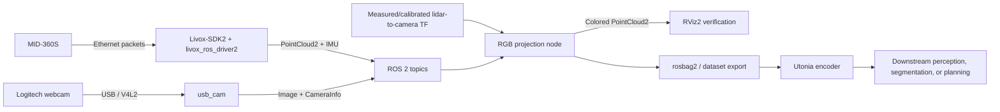

# Livox MID-360S + Logitech camera setup

This guide targets the Jetson in this repository: Ubuntu 24.04 (aarch64), ROS 2
Jazzy, and a Livox MID-360S connected to `end0` by Ethernet.

## Current installation status (2026-11-11)

- ROS 2 Jazzy desktop and RViz2: installed
- Livox-SDK2: built and installed from the official repository
- `livox_ros_driver2`: built in `/home/sohom/ws_livox`
- ROS camera packages: `usb_cam`, `camera_calibration`, `image_pipeline`, and
  `image_view` installed
- PCL, `pcl_conversions`, `cv_bridge`, TF2, and `v4l-utils`: installed
- Logitech Brio 105 detected at `/dev/video0`; ROS topics `/image_raw` and
  `/camera_info` verified
- Camera intrinsics: not calibrated yet
- MID-360S powered and reachable at `192.168.1.166` through `end0`
- Jetson `end0` persistently configured as `192.168.1.50/24`, with no gateway
- LiDAR PointCloud2 verified at 10 Hz and IMU verified at approximately 200 Hz
- RViz2 verified subscribing to `/livox/lidar` in frame `livox_frame`
- LiDAR-to-camera extrinsics and RGB point-cloud projection: not calibrated or
  implemented yet
- Utonia: intentionally not installed yet; sensor acquisition and calibration
  must work first

## What a point cloud is

A point cloud is a set of 3D samples. Each LiDAR return contains at least a
position `(x, y, z)` in the LiDAR coordinate frame and usually intensity,
return type, timestamp, and line/tag metadata. One scan therefore describes
visible surfaces as points, not as solid objects or a complete mesh.

For RGB mapping, each LiDAR point is transformed from the LiDAR frame into the
camera frame, projected through the calibrated camera model to pixel `(u, v)`,
and assigned that pixel's RGB value. The result is a colored point cloud with
fields such as `(x, y, z, r, g, b)`. Accurate color requires:

1. camera intrinsics and lens distortion;
2. the rigid 6-DoF transform between LiDAR and camera (extrinsics);
3. sufficiently synchronized LiDAR and image timestamps;
4. visibility/occlusion and image-bound checks.

LiDAR alone does not create a persistent 3D architecture. It produces scans.
Building a map over motion additionally requires localization/odometry and a
mapping system (for example a LiDAR-inertial SLAM pipeline).

## Component flow



RViz2 is the inspection dashboard in this flow. It does not drive the sensor,
calibrate it, synchronize streams, color points, perform SLAM, or run Utonia.
It displays images, point clouds, TF frames, and the eventual colored cloud so
frame, timing, field, and alignment errors are visible.

## Bring-up order

### 1. Source ROS and the Livox workspace

Run this in every new terminal:

```bash
source /opt/ros/jazzy/setup.bash
source /home/sohom/ws_livox/install/setup.bash
```

Do not source the workspace from `.bashrc` until bring-up is stable; explicit
sourcing makes environment mistakes easier to diagnose.

### 2. Mount the sensors rigidly

Use a bracket that prevents any relative camera/LiDAR movement. Keep both
fields of view overlapping and record the axis directions. Any later movement
invalidates the extrinsic calibration. Power the MID-360S using the specified
Livox cable/supply; Ethernet does not power it unless the exact hardware/cable
supports the required power arrangement.

### 3. Configure the LiDAR Ethernet link

This rig is now configured as:

- Jetson host: `192.168.1.50/24`
- LiDAR: `192.168.1.166`
- interface: `end0` on this Jetson

After connecting and powering the LiDAR, identify the NetworkManager profile:

```bash
nmcli device status
nmcli connection show
```

The NetworkManager profile is named `Wired connection 1`. Its persistent
configuration was created with:

```bash
sudo nmcli connection modify "Wired connection 1" \
  ipv4.method manual ipv4.addresses 192.168.1.50/24 ipv4.gateway "" \
  ipv4.dns "" ipv4.never-default yes
sudo nmcli connection up "Wired connection 1"
ip -brief address show end0
ping -c 3 192.168.1.166
```

Wi-Fi can remain the default internet route. Do not add a gateway on the LiDAR
Ethernet profile.

The active MID-360S template is:

`/home/sohom/ws_livox/src/livox_ros_driver2/config/MID360s_config.json`

Its `host_ip` is `192.168.1.50` and its LiDAR `ip` is `192.168.1.166`. These
were verified on the live link; do not restore the template addresses.

### 4. Start and verify the MID-360S

```bash
source /opt/ros/jazzy/setup.bash
source /home/sohom/ws_livox/install/setup.bash
ros2 launch livox_ros_driver2 rviz_MID360s_launch.py
```

In a second sourced terminal:

```bash
ros2 topic list | sort
ros2 topic info /livox/lidar --verbose
ros2 topic hz /livox/lidar
ros2 topic echo /livox/lidar --once
```

If the exact topic differs, use `ros2 topic list` and inspect the topic whose
type is `sensor_msgs/msg/PointCloud2`. In RViz2 set Fixed Frame to the cloud's
`header.frame_id`, add a PointCloud2 display, and select that topic.

### 5. Start and verify the Logitech camera

The detected webcam is a Logitech Brio 105 at `/dev/video0`. The calibrated
operating mode is 1280 x 720 MJPEG at 30 FPS:

```bash
source /opt/ros/jazzy/setup.bash
ros2 run usb_cam usb_cam_node_exe --ros-args \
  -p video_device:=/dev/video0 \
  -p camera_name:=logitech_brio105 \
  -p image_width:=1280 -p image_height:=720 -p framerate:=30.0 \
  -p pixel_format:=mjpeg2rgb \
  -p frame_id:=camera_optical_frame
```

Verify from another terminal:

```bash
ros2 topic list | sort
ros2 topic hz /image_raw
ros2 run image_view image_view --ros-args -r image:=/image_raw
```

For higher resolutions, query supported modes with:

```bash
v4l2-ctl --device /dev/video0 --list-formats-ext
```

Prefer MJPEG for higher resolution/frame-rate modes to reduce USB bandwidth,
but confirm that `usb_cam` is configured for a supported pixel format.

### 6. Calibrate camera intrinsics

The accepted calibration used a rigid checkerboard with 9 x 7 **internal
corners** (10 x 8 printed squares) and 20 mm squares:

```bash
ros2 run camera_calibration cameracalibrator \
  --size 9x7 --square 0.020 \
  --camera_name logitech_brio105 \
  --max-chessboard-speed 0.5 \
  --ros-args \
  -r image:=/image_raw \
  -r camera/set_camera_info:=/usb_cam/set_camera_info
```

The accepted result has 0.682-pixel reprojection RMS. The installed file is
`~/.ros/camera_info/logitech_brio105.yaml`; the project copy is
`config/camera/logitech_brio105_1280x720.yaml`. It was verified after a
camera-node restart and through `/image_rect` from `image_proc`. This
calibration is specific to 1280 x 720 and the camera's fixed focus.

### 7. Establish TF frames and calibrate LiDAR-camera extrinsics

Use a frame tree such as:

```text
base_link
├── lidar_link
└── camera_link
    └── camera_optical_frame
```

ROS optical axes are normally `z` forward, `x` right, `y` down. A ruler-based
static transform is acceptable only for rough visualization. RGB projection
needs target-based LiDAR-camera extrinsic calibration and a saved transform
containing translation plus rotation. Publish the final transform with a
URDF/robot-state-publisher or a static transform publisher, then verify it:

```bash
ros2 run tf2_tools view_frames
ros2 run tf2_ros tf2_echo lidar_link camera_optical_frame
```

The camera's intrinsic calibration is not the same as LiDAR-camera extrinsic
calibration; both are mandatory.

### 8. Time synchronization and RGB projection

For a stationary rig/scene, software timestamp matching is enough for initial
testing. For a moving JetRacer, timestamp error produces visible color trails
and must be treated as a first-class requirement. Prefer hardware-supported
time synchronization when available; otherwise use closest-timestamp or
approximate-time synchronization and measure the residual offset.

The projection node will:

1. receive `PointCloud2`, `Image`, and `CameraInfo`;
2. select a time-aligned cloud/image pair;
3. transform each LiDAR point into `camera_optical_frame` using TF2;
4. reject points behind the camera;
5. rectify/project with the camera model;
6. reject pixels outside the image and handle occlusion (nearest depth wins);
7. copy RGB into a new `PointCloud2` and publish it;
8. show both source and colored clouds in RViz2 and record a rosbag.

Implement this only after steps 4-7 pass independently.

### 9. Record repeatable test data

```bash
ros2 bag record /livox/lidar /livox/imu /image_raw /camera_info /tf /tf_static
```

Adjust topic names to the actual driver output. Start with a static scene
containing textured objects at several depths, then test motion. Bags let us
debug calibration and projection without repeatedly operating hardware.

## Required setup checklist

- [x] Ubuntu 24.04 / ROS 2 Jazzy
- [x] RViz2, TF2, PCL conversions, and cv_bridge
- [x] Livox-SDK2 and `livox_ros_driver2` with MID-360S launch files
- [x] `usb_cam`, image pipeline/view, camera calibration, and V4L2 tools
- [x] Logitech camera detected and ROS image topics smoke-tested
- [x] MID-360S powered, Ethernet link active, and correct device IP known
- [x] Jetson wired profile set to the same `/24` subnet with no gateway
- [x] LiDAR PointCloud2 and IMU topics verified in ROS and RViz2
- [x] Camera intrinsic YAML generated and rectification verified at 1280 x 720
- [ ] Rigid camera/LiDAR bracket and coordinate-frame convention documented
- [ ] LiDAR-camera extrinsic transform calibrated and stored
- [ ] Sensor timestamp offset measured; synchronization strategy selected
- [ ] RGB projection/colorized PointCloud2 node implemented and tested
- [ ] Rosbag validation dataset recorded
- [ ] SLAM/odometry selected if a persistent map is required
- [ ] Utonia installed in an isolated environment and fed exported point data

## Where Utonia fits

Utonia is a learned point-cloud encoder, not a LiDAR driver, ROS visualizer,
SLAM package, or RGB projection/calibration tool. Its expected sample contains
`coord`, `color`, and `normal` arrays (missing color/normal can be zeros). It
belongs after reliable point-cloud acquisition, optional mapping, RGB fusion,
normal estimation, filtering/downsampling, and conversion from ROS messages or
bags into NumPy/dataset samples.

The upstream environment pins Python 3.10, PyTorch 2.5, and CUDA 12.4. This
Jetson currently uses Python 3.12 and CUDA 13.2, so installing that environment
directly into the system Python risks breaking the working JetPack stack.
Evaluate the tiny model first in a separate container or compatible virtual
environment, with FlashAttention disabled if no matching Jetson wheel/build is
available. Utonia integration is therefore a later milestone, not part of
sensor bring-up.

## Installed locations

```text
/home/sohom/Livox-SDK2                 official SDK source/build
/usr/local/lib/liblivox_lidar_sdk_*    installed SDK libraries
/home/sohom/ws_livox/src/livox_ros_driver2
/home/sohom/ws_livox/install           ROS 2 workspace overlay
```

## Primary references

- Livox ROS Driver 2: https://github.com/Livox-SDK/livox_ros_driver2
- Livox-SDK2: https://github.com/Livox-SDK/Livox-SDK2
- MID-360 downloads/manuals: https://www.livoxtech.com/mid-360/downloads
- ROS 2 Jazzy documentation: https://docs.ros.org/en/jazzy/
- Utonia inference code: https://github.com/Pointcept/Utonia
- Utonia paper: https://arxiv.org/abs/2603.03283
- Utonia weights/model card: https://huggingface.co/Pointcept/Utonia
